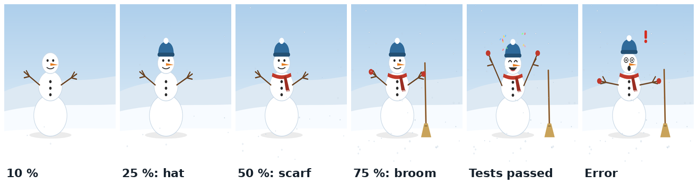

# Winterlandschaft

[English](README.md) · **Deutsch**

[](https://github.com/PurpleProgrammer/claude-background/actions/workflows/check.yml)


Ein Hintergrund für die Claude-App (Desktop und Mobil): eine schlichte Landschaft, die auf deine Sitzung reagiert.

- **Kontext:** Je voller der Kontext, desto dichter fällt der Schnee. Der Schneemann bekommt ab 25 % eine Mütze, ab 50 % einen Schal und ab 75 % Besen und Fäustlinge.
- **Modell:** Oben links stehen das aktuelle Modell und der Kontext-Füllstand. Jedes Modell hat sein eigenes Wetter: Opus klar, Sonnet Abendrot (nachts Nordlicht), Haiku Nebel.
- **Stimmungen:** Bei bestandenen Tests jubelt der Schneemann (Arme hoch, Hüpfen, Konfetti). Bei fehlgeschlagenen Tests und Fehlern erschrickt er (grosse Augen, die Mütze fliegt hoch, rotes „!“).
- **Klick auf den Hintergrund:** Schneegestöber, Schnee rieselt von den Tannen, Mond oder Sonne lächelt.
- **Jahreszeiten mit Übergängen:** Im November wird der Schneemann gebaut, im März schmilzt er. Im Frühling blühen Blumen, im Sommer und Herbst steht eine Vogelscheuche.
- **Anlässe:** Ostern, 1. August, Advent, Weihnachten, Silvester und Neujahr.

## Galerie

**Jahreszeiten, Wetter je Modell und Anlässe**


**Accessoires je nach Kontext und die Stimmungen**



Die Bildbeschriftungen sind englisch, weil die Bilder für beide READMEs dieselben sind.

## Installation

In einer Terminal-Sitzung von Claude Code:

```
/plugin install winter-landscape --marketplace PurpleProgrammer/claude-background
```

Danach `y` drücken, um den Marketplace hinzuzufügen, und mit Enter den Bereich wählen.

Aus einer Shell:

```bash
claude plugin install winter-landscape --marketplace PurpleProgrammer/claude-background
```

In der Desktop-App, wo `/plugin` nicht läuft: auf **+** neben dem Eingabefeld klicken, dann **Plugins**, **Add marketplace** mit `PurpleProgrammer/claude-background`, dann **Add plugin**.

Der Hintergrund erscheint in der Desktop- und der Mobil-App. Im Terminal wird kein Hintergrund gezeichnet.

## Auf Deutsch umstellen

In [`hooks/settings.ts`](hooks/settings.ts) `language: 'en'` durch `language: 'de'` ersetzen. Danach sind die Anzeige in der Szene und die Antworten von `/winter` deutsch.

## Vorschau mit `/winter`

Die deutschen Wörter funktionieren immer, auch wenn die Sprache auf Englisch steht.

| Befehl | Wirkung |
|---|---|
| `/winter` | zeigt den aktuellen Zustand |
| `/winter ostern` | Jahreszeit oder Anlass ansehen: `winter`, `ersterschnee`, `tauwetter`, `frühling`, `sommer`, `herbst`, `ostern`, `nationalfeiertag`, `advent`, `weihnachten`, `silvester`, `neujahr` |
| `/winter datum 2027-03-20` | beliebiges Datum |
| `/winter wetter nebel` | Wetter `klar`, `abendrot` oder `nebel` |
| `/winter kontext 80` | Kontext-Füllstand simulieren |
| `/winter jubel` · `/winter schreck` | Figur jubeln oder erschrecken lassen |
| `/winter zurück` | Vorschau beenden |

## Anpassen

Alle Einstellungen stehen mit Kommentaren in [`hooks/settings.ts`](hooks/settings.ts): Sprache, Anzahl Tannen, Figurgrösse, Farben der Accessoires, Prozent-Stufen, Flockenmenge, Wetter je Modell, Dauer von Klick-Effekten und Stimmungen, Anlässe und die Kalenderdaten für Schnee und Tauwetter.

## Entwicklung

Bei jedem Push und Pull Request führt GitHub Actions `claude plugin validate .` und `claude plugin test .` aus ([Workflow](.github/workflows/check.yml)). Das Badge oben zeigt das letzte Ergebnis.

## Herkunft

`hooks/make-colors.js` und `hooks/make-colors.d.ts` stammen unverändert aus dem Plugin-Baukasten von Claude Code, der sie zum Einbauen in Mods bereitstellt. Für sie gelten weiterhin die ursprünglichen Bedingungen.

## Lizenz

[MIT](LICENSE)
