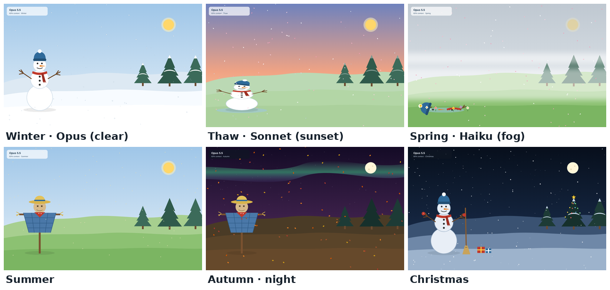

# Interactive Background for Claude

[English](README.md) · **Deutsch**

[](https://github.com/PurpleProgrammer/claude-background/actions/workflows/check.yml)


Ein lebendiger Hintergrund für die Claude-App (Desktop und Mobil): eine schlichte Landschaft, die deiner Sitzung, den Jahreszeiten und dem Kalender deines Wohnorts folgt.

- **Kontext:** Je voller der Kontext, desto mehr Schnee (oder Blätter, Blüten) fällt. Die Figur bekommt ab 25 % eine Mütze, ab 50 % einen Schal und ab 75 % Besen und Fäustlinge.
- **Modell:** Oben rechts stehen das aktuelle Modell und der Kontext-Füllstand. Jedes Modell hat sein eigenes Wetter: Opus klar, Sonnet Abendrot (nachts Nordlicht), Haiku Nebel, Fable Zauber (funkelnde Sterne und Sternschnuppen am fliederfarbenen Himmel).
- **Stimmungen:** Bei bestandenen Tests jubelt die Figur (Arme hoch, Hüpfen, Konfetti). Bei fehlgeschlagenen Tests und Fehlern erschrickt sie (grosse Augen, die Mütze fliegt hoch, rotes „!“).
- **Klick auf den Hintergrund:** Gestöber, Schnee rieselt von den Tannen, Mond oder Sonne lächelt.
- **Jahreszeiten mit Übergängen:** Im November wird der Schneemann gebaut, im März schmilzt er. Im Frühling blühen Blumen, im Sommer und Herbst steht eine Vogelscheuche. Auf der Südhalbkugel laufen die Jahreszeiten gespiegelt.
- **Anlässe und Verkleidungen:** rund 60 Anlässe aus vielen Ländern und Kulturen, jeder mit eigener Deko, und für viele verkleidet sich die Figur.
- **Fünf Sprachen:** Englisch, Deutsch, Französisch, Italienisch und Spanisch.

## Galerie

**Jahreszeiten und Wetter je Modell**



**Anlässe und Verkleidungen**


**Accessoires je nach Kontext und die Stimmungen**


Die Bildbeschriftungen sind englisch, weil die Bilder für beide READMEs dieselben sind.

## Installation

In einer Terminal-Sitzung von Claude Code:

```
/plugin install interactive-background --marketplace PurpleProgrammer/claude-background
```

Danach `y` drücken, um den Marketplace hinzuzufügen, und mit Enter den Bereich wählen.

Aus einer Shell:

```bash
claude plugin install interactive-background --marketplace PurpleProgrammer/claude-background
```

In der Desktop-App, wo `/plugin` nicht läuft: auf **+** neben dem Eingabefeld klicken, dann **Plugins**, **Add marketplace** mit `PurpleProgrammer/claude-background`, dann **Add plugin**.

Der Hintergrund erscheint in der Desktop- und der Mobil-App. Im Terminal wird kein Hintergrund gezeichnet. Auf dem Handy im Hochformat passt nur die Mitte der Landschaft auf den Bildschirm.

## Regionen & Anlässe

Die Mod erkennt aus Zeitzone und Locale deines Systems, wo du bist, ohne Netzwerkzugriff, und zeigt die Anlässe dieses Landes. `/backdrop` zeigt, was erkannt wurde, zum Beispiel `Region: CH (erkannt über Europe/Zurich)`. Was du von Hand einstellst, gewinnt immer.

> **Cloud-Sitzungen:** Ein Cloud-Rechner meldet meist `UTC` und `en-US` und wird deshalb als USA erkannt. Gib einmal `/backdrop region CH` ein (mit deinem eigenen Ländercode). Die Wahl wird gemerkt, und die Tage zählen dann in der Zeitzone dieses Landes.

| Anlässe | Erscheinen in |
|---|---|
| Silvester, Neujahr, Valentinstag, Tag der Frau, Halloween, Sommersonnenwende (21. Juni im Norden, 21. Dezember im Süden) | überall |
| Ostern, Advent, Weihnachten | Europa, Amerika, Ozeanien und weitere Länder, in denen sie Feiertage sind |
| Orthodoxe Ostern | GR, CY, RO, BG, RS, UA, RU, GE, MK, ME, BA, ET |
| Fasnacht | CH (Daten je nach Ort), DE, AT, BE, NL, LU, LI, IT, ES, PT, BR (Samstag bis Dienstag) … |
| Auffahrt, Pfingsten | CH, LI, DE, AT, FR, BE, NL, LU, DK, NO, SE, FI |
| Muttertag, Vatertag | je nach Land (2. Sonntag im Mai, Mothering Sunday, letzter Maisonntag in Frankreich, 10. Mai in Mexiko …) |
| Dreikönigstag, St. Patrick's Day, Martinstag, St. Nikolaus (in NL und BE am 5. Dezember), Luciafest, Mittsommer, Boxing Day | in den Ländern, die sie feiern |
| Nationalfeiertage | CH, DE, AT, LI, FR, IT, ES, NL, US, CA, MX, BR, NZ, IN, PL, UA, NO; Australia Day nur, wenn eingeschaltet |
| Thanksgiving, Labor Day im September | US, CA |
| Guy-Fawkes-Nacht | GB |
| Tag der Toten | MX |
| Kindertag, Tanabata, Kirschblütenzeit | JP |
| Chinesisches Neujahr, Mondfest | CN, TW, HK, MO, SG, MY, VN (Neujahr auch KR) |
| Nouruz | IR, AF, AZ, TJ, KZ, UZ, KG, TM |
| Ramadan, Zuckerfest, Opferfest | Länder mit muslimischer Mehrheit |
| Chanukka | IL |
| Diwali, Holi, Vesakh | IN, NP und weitere (aus veröffentlichten Kalendern 2026–2036; Jahre ohne gesichertes Datum fallen weg) |
| Kwanzaa | nur mit `extraOccasions` |

Das Sechseläuten erscheint mit `subdivision: 'CH-ZH'`. `/backdrop anlässe` listet die Anlässe deiner Region mit ihrem nächsten Datum.

Islamische Daten folgen dem Umm-al-Qura-Kalender und können vom Tag, der bei dir gefeiert wird, um einen Tag abweichen.

### Einstellungen für Regionen

| Einstellung | Werte | Wirkung |
|---|---|---|
| `region` | `'auto'` oder Ländercode (`'CH'`, `'DE'`, `'US'` …) | wessen Anlässe erscheinen |
| `subdivision` | `''` oder z. B. `'CH-ZH'`, `'CH-BS'`, `'CH-BE'`, `'CH-LU'` | lokale Bräuche wie Fasnachtsdaten und Sechseläuten (wird nie geraten) |
| `timeZone` | `'auto'` oder z. B. `'Europe/Zurich'` | welcher Kalendertag zählt |
| `hemisphere` | `'auto'`, `'north'`, `'south'` | in welche Richtung die Jahreszeiten laufen |
| `snow` | `true` / `false` | `false`: kein Schneemann, das ganze Jahr eine Sommerfigur, im Winter Regen |
| `extraOccasions` | Liste von Anlass-IDs | zusätzlich Anlässe aus anderen Regionen oder Kulturen |
| `occasions` | `true` / `false` je Anlass | einzelne Anlässe ein- oder ausschalten |

Beispiel: in der Schweiz zusätzlich Diwali und Chanukka, aber kein Halloween:

```ts
region: 'CH',
subdivision: 'CH-ZH',
extraOccasions: ['diwali', 'hanukkah'],
occasions: { ..., halloween: false },
```

### Ein Land hinzufügen

Pull Requests sind willkommen. Ein neues Land braucht meist nur:

1. **Einen Eintrag** in [`hooks/occasions.ts`](hooks/occasions.ts): den Ländercode bei einem bestehenden Anlass unter `regions` ergänzen (oder in einer Gruppe wie `CHRISTMAS`), oder einen neuen Eintrag mit seiner `days`-Regel anlegen. Ein Nationalfeiertag braucht nur seine Farben in `NATIONAL_COLORS` in [`hooks/decor.ts`](hooks/decor.ts).
2. **Seinen Namen in jeder Sprache** in [`hooks/i18n.ts`](hooks/i18n.ts); die Typprüfung schlägt fehl, solange einer fehlt.

Daten, die `Intl` nicht berechnen kann, stammen aus veröffentlichten Kalendern, mit Quelle im Kommentar. Bitte nicht schätzen.

## Sprachen

Setze `language` in [`hooks/settings.ts`](hooks/settings.ts) auf `'en'`, `'de'`, `'fr'`, `'it'`, `'es'`, oder auf `'auto'` für die Sprache deines Systems. Namen, die sich je nach Land unterscheiden, sind berücksichtigt (zum Beispiel „Labor Day“ in den USA, „Fête nationale“ in der Romandie). Eine weitere Sprache ist als Pull Request willkommen: ein weiteres `Texts`-Objekt und seine Wörter in `WORDS`.

## Befehle

`/backdrop` (Kurzform `/winter`; `/background` belegt die App selbst). Die Wörter funktionieren in allen fünf Sprachen, Akzente sind optional.

| Befehl | Wirkung |
|---|---|
| `/backdrop` | zeigt den aktuellen Zustand, auch die Region und woher sie erkannt wurde |
| `/backdrop sommer` | Jahreszeit ansehen: `winter`, `ersterschnee`, `tauwetter`, `frühling`, `sommer`, `herbst` |
| `/backdrop halloween` | Anlass ansehen, über seine ID oder seinen Namen, z. B. `ostern`, `diwali`, `erntedank`, `chinesischesneujahr`, `königstag` |
| `/backdrop datum 2027-03-20` | beliebiges Datum |
| `/backdrop wetter zauber` | Wetter `klar`, `abendrot`, `nebel` oder `zauber` |
| `/backdrop kontext 80` | Kontext-Füllstand simulieren |
| `/backdrop jubel` · `/backdrop schreck` | Figur jubeln oder erschrecken lassen |
| `/backdrop fallen kurz` | Schnee und Blätter fallen nur ein paar Sekunden nach jeder Änderung, dann wird der Himmel klar |
| `/backdrop fallen einfrieren` | ebenso, aber alles bleibt in der Luft stehen; `immer` und `aus` gehen auch, die Wahl wird gemerkt |
| `/backdrop figur 20` · `/backdrop mond 85` | Figur oder Mond verschieben (Prozent der Fensterbreite); `/backdrop anordnung zurück` stellt die Einstellungen wieder her |
| `/backdrop region DE` · `/backdrop region auto` | Anlässe eines anderen Landes zeigen und merken, oder wieder erkennen |
| `/backdrop anlässe` | die Anlässe deiner Region mit ihrem nächsten Datum |
| `/backdrop zurück` | Vorschau beenden |
| `/backdrop hilfe` | die Hilfe, in deiner Sprache |

## Anpassen

Alle Einstellungen stehen mit Kommentaren in [`hooks/settings.ts`](hooks/settings.ts): Sprache, Position der Anzeige, Anordnung, Fall-Modus, Regionen (siehe oben), Verkleidungen, Anzahl Tannen und Grösse der Figur, Farben der Accessoires, Kontext-Stufen, Flockenmenge, Wetter je Modell, Dauer von Klick-Effekten und Stimmungen, Anlässe und der Kalender für ersten Schnee und Tauwetter.

## Entwicklung

Bei jedem Push und Pull Request führt GitHub Actions `claude plugin validate .` und `claude plugin test .` aus ([Workflow](.github/workflows/check.yml)). Das Badge oben zeigt das letzte Ergebnis. Die Tests prüfen unter anderem Tag für Tag, dass die Schweiz genau die Anlässe behält, die sie vor den Regionen hatte.

Die Zeitzonen-Tabelle `hooks/zones.ts` wird mit `node scripts/make-zones.mjs` aus der IANA-Datenbank erzeugt.

**Offener Punkt:** `docs/images/occasions.png` zeigt noch nur die Schweizer Anlässe und sollte mit den neuen neu erzeugt werden.

## Herkunft

`hooks/make-colors.js` und `hooks/make-colors.d.ts` stammen unverändert aus dem Plugin-Baukasten von Claude Code, der sie zum Einbauen in Mods bereitstellt. Für sie gelten weiterhin die ursprünglichen Bedingungen.

## Lizenz

[MIT](LICENSE)
