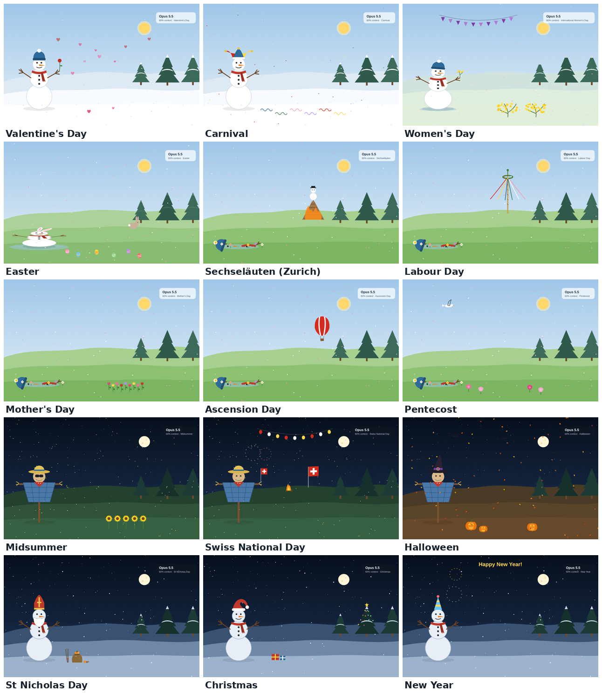

# Interactive Background for Claude

[English](README.md) · **Deutsch**

[](https://github.com/PurpleProgrammer/claude-background/actions/workflows/check.yml)


Ein lebendiger Hintergrund für die Claude-App (Desktop und Mobil): eine schlichte Landschaft, die deiner Sitzung, den Jahreszeiten und dem Kalender folgt.

- **Kontext:** Je voller der Kontext, desto mehr Schnee (oder Blätter, Blüten) fällt. Die Figur bekommt ab 25 % eine Mütze, ab 50 % einen Schal und ab 75 % Besen und Fäustlinge.
- **Modell:** Oben rechts stehen das aktuelle Modell und der Kontext-Füllstand. Jedes Modell hat sein eigenes Wetter: Opus klar, Sonnet Abendrot (nachts Nordlicht), Haiku Nebel, Fable Zauber (funkelnde Sterne und Sternschnuppen am fliederfarbenen Himmel).
- **Stimmungen:** Bei bestandenen Tests jubelt die Figur (Arme hoch, Hüpfen, Konfetti). Bei fehlgeschlagenen Tests und Fehlern erschrickt sie (grosse Augen, die Mütze fliegt hoch, rotes „!“).
- **Klick auf den Hintergrund:** Gestöber, Schnee rieselt von den Tannen, Mond oder Sonne lächelt.
- **Jahreszeiten mit Übergängen:** Im November wird der Schneemann gebaut, im März schmilzt er. Im Frühling blühen Blumen, im Sommer und Herbst steht eine Vogelscheuche.
- **Anlässe und Verkleidungen:** 17 Anlässe mit eigener Deko, und für viele davon verkleidet sich die Figur.

| Anlass | Datum | Deko | Verkleidung |
|---|---|---|---|
| Valentinstag | 14. Feb. | aufsteigende Herzen | eine Rose |
| Fasnacht | je nach Ort (Basel, Bern, Luzern und übrige Schweiz) | Konfetti und Luftschlangen | Narrenkappe |
| Tag der Frau | 8. März | Mimosen, violette Wimpelkette | ein Mimosenzweig |
| Ostern | Karfreitag bis Ostermontag | Eier und ein Osterhase | Hasenohren |
| Sechseläuten | 3. Montag im April, nur in Zürich | der Böögg auf dem Scheiterhaufen | |
| Tag der Arbeit | 1. Mai | ein Maibaum | |
| Muttertag | 2. Sonntag im Mai | Tulpen | ein Blumenstrauss |
| Auffahrt | Ostern + 39 Tage | ein Heissluftballon | |
| Pfingsten | Pfingstsonntag und -montag | eine Taube und Pfingstrosen | |
| Sommersonnenwende | 21. Juni | Sonnenblumen, nachts Glühwürmchen | Sonnenbrille |
| 1. August | 31. Juli bis 1. August | Fahne, Lampions, Höhenfeuer, Feuerwerk | eine Schweizerfahne |
| Halloween | 30. bis 31. Okt. | Kürbislaternen und Fledermäuse | Hexenhut |
| St. Nikolaus | 6. Dez. | ein Sack mit Mandarinen und Nüssen | Mitra und Bart |
| Advent | 1. bis 23. Dez. | Lichterkette an der Tanne | |
| Weihnachten | 24. bis 26. Dez. | Stern, Lichter und Geschenke | Weihnachtsmütze |
| Silvester, Neujahr | 31. Dez., 1. Jan. | Feuerwerk, Neujahrsgruss | Partyhut |

## Galerie

**Jahreszeiten und Wetter je Modell**


**Anlässe und Verkleidungen**



**Accessoires je nach Kontext und die Stimmungen**


Die Bildbeschriftungen sind englisch, weil die Bilder für beide READMEs dieselben sind.

## Installation

In einer Terminal-Sitzung von Claude Code:

```
/plugin install interactive-background --marketplace PurpleProgrammer/claude-background
```

Danach `y` drücken, um den Marketplace hinzuzufügen, und mit Enter den Bereich wählen.

Aus einer Shell:

```bash
claude plugin install interactive-background --marketplace PurpleProgrammer/claude-background
```

In der Desktop-App, wo `/plugin` nicht läuft: auf **+** neben dem Eingabefeld klicken, dann **Plugins**, **Add marketplace** mit `PurpleProgrammer/claude-background`, dann **Add plugin**.

Der Hintergrund erscheint in der Desktop- und der Mobil-App. Im Terminal wird kein Hintergrund gezeichnet. Auf dem Handy im Hochformat passt nur die Mitte der Landschaft auf den Bildschirm.

## Auf Deutsch umstellen

In [`hooks/settings.ts`](hooks/settings.ts) `language: 'en'` durch `language: 'de'` ersetzen. Danach sind die Anzeige in der Szene und die Antworten von `/background` deutsch.

## Vorschau mit `/background`

`/winter` ist die Kurzform und macht dasselbe. Die deutschen Wörter funktionieren immer, auch wenn die Sprache auf Englisch steht.

| Befehl | Wirkung |
|---|---|
| `/background` | zeigt den aktuellen Zustand |
| `/background sommer` | Jahreszeit ansehen: `winter`, `ersterschnee`, `tauwetter`, `frühling`, `sommer`, `herbst` |
| `/background halloween` | Anlass ansehen: `valentinstag`, `fasnacht`, `tagderfrau`, `ostern`, `sechseläuten`, `tagderarbeit`, `muttertag`, `auffahrt`, `pfingsten`, `sonnenwende`, `nationalfeiertag`, `halloween`, `nikolaus`, `advent`, `weihnachten`, `silvester`, `neujahr` |
| `/background datum 2027-03-20` | beliebiges Datum |
| `/background wetter zauber` | Wetter `klar`, `abendrot`, `nebel` oder `zauber` |
| `/background kontext 80` | Kontext-Füllstand simulieren |
| `/background jubel` · `/background schreck` | Figur jubeln oder erschrecken lassen |
| `/background zurück` | Vorschau beenden |

## Anpassen

Alle Einstellungen stehen mit Kommentaren in [`hooks/settings.ts`](hooks/settings.ts):

- `language`: `'en'` oder `'de'` für alle Texte in der Szene und in `/background`
- `label`: oben rechts oder oben links, und der Abstand zum Fensterrand
- `location`: dein Ort (`zurich`, `basel`, `bern`, `lucerne` oder `other`) für die Fasnachtsdaten und das Sechseläuten
- `costumes`: ob sich die Figur an Anlässen verkleidet
- Anzahl Tannen und Grösse der Figur
- Farben von Mütze, Bommel, Schal, Fäustlingen und Besen
- die Kontext-Stufen der Accessoires
- wie viele Flocken bei leerem und vollem Kontext fallen
- Wetter je Modell
- Dauer von Klick-Effekten und Stimmungen, und ob jeder Fehler die Figur erschreckt
- welche Anlässe gezeigt werden
- Kalenderdaten für den ersten Schnee und das Tauwetter

## Entwicklung

Bei jedem Push und Pull Request führt GitHub Actions `claude plugin validate .` und `claude plugin test .` aus ([Workflow](.github/workflows/check.yml)). Das Badge oben zeigt das letzte Ergebnis.

## Herkunft

`hooks/make-colors.js` und `hooks/make-colors.d.ts` stammen unverändert aus dem Plugin-Baukasten von Claude Code, der sie zum Einbauen in Mods bereitstellt. Für sie gelten weiterhin die ursprünglichen Bedingungen.

## Lizenz

[MIT](LICENSE)
