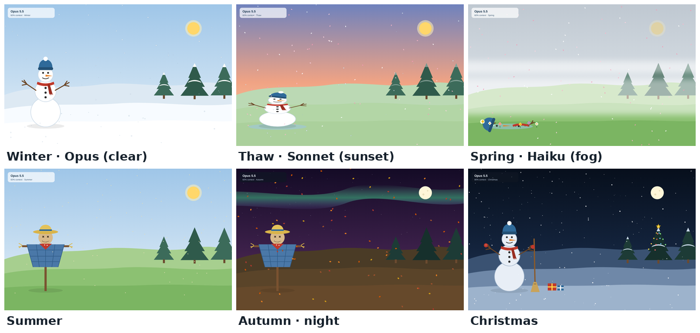
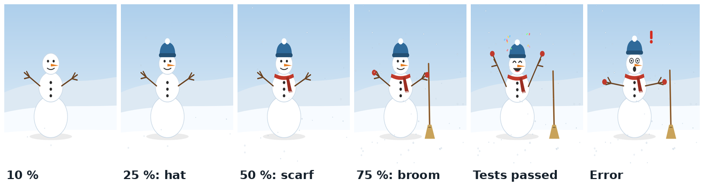

# Winter Landscape

**English** · [Deutsch](README.de.md)

[](https://github.com/PurpleProgrammer/claude-background/actions/workflows/check.yml)


A background for the Claude app (desktop and mobile): a simple landscape that follows your session.

- **Context:** the fuller the context, the heavier the snowfall. The snowman puts on a hat at 25 %, a scarf at 50 % and a broom with mittens at 75 %.
- **Model:** the current model and how full the context is are shown top right (or top left, see settings). Each model has its own weather: Opus clear, Sonnet sunset (northern lights at night), Haiku fog, Fable magic (twinkling stars and shooting stars on a lilac sky).
- **Moods:** passing tests make the snowman cheer (arms up, hopping, confetti). Failing tests and errors give it a fright (wide eyes, hat pops up, a red “!”).
- **Click the background:** a snow flurry, snow falls off the fir trees, and the moon or sun smiles.
- **Seasons with smooth transitions:** the snowman is built in November and melts in March. Flowers bloom in spring, and a scarecrow takes over in summer and autumn.
- **Occasions:** International Women's Day (mimosa and a violet bunting), Easter, Labour Day (a maypole), Pentecost (a dove and peonies), Swiss National Day (1 August), Halloween (jack-o'-lanterns and bats), Advent, Christmas, New Year's Eve and New Year.

## Gallery

**Seasons, weather per model and occasions**



**Accessories as the context fills, and the moods**



## Installation

At the prompt of a Claude Code terminal session:

```
/plugin install winter-landscape --marketplace PurpleProgrammer/claude-background
```

Then press `y` to add the marketplace and Enter to choose the scope.

From a shell:

```bash
claude plugin install winter-landscape --marketplace PurpleProgrammer/claude-background
```

In the desktop app, where `/plugin` does not run: click **+** next to the prompt box, then **Plugins**, **Add marketplace** with `PurpleProgrammer/claude-background`, then **Add plugin**.

The background shows in the desktop and mobile apps. The terminal draws no background.

## Preview with `/winter`

| Command | Effect |
|---|---|
| `/winter` | show the current state |
| `/winter easter` | preview a season or occasion: `winter`, `firstsnow`, `thaw`, `spring`, `summer`, `autumn`, `womensday`, `easter`, `labourday`, `pentecost`, `nationalday`, `halloween`, `advent`, `christmas`, `newyearseve`, `newyear` |
| `/winter date 2027-03-20` | any date |
| `/winter weather fog` | weather `clear`, `sunset`, `fog` or `magic` |
| `/winter context 80` | simulate how full the context is |
| `/winter cheer` · `/winter fright` | let the figure cheer or get a fright |
| `/winter reset` | end all previews |

## Customising

Every setting is in [`hooks/settings.ts`](hooks/settings.ts), with a comment for each:

- `language`: `'en'` or `'de'` for all texts in the scene and in `/winter`
- `label`: top right or top left, and the distance from the window's edges
- number of fir trees and size of the figure
- colours of hat, pompom, scarf, mittens and broom
- the context stages for the accessories
- how many flakes fall with an empty and a full context
- weather per model
- how long click effects and moods last, and whether any error startles the figure
- which occasions are shown
- calendar dates for the first snow and the thaw

## Development

Every push and pull request runs `claude plugin validate .` and `claude plugin test .` on GitHub Actions ([workflow](.github/workflows/check.yml)). The badge at the top shows the latest result.

## Credits

`hooks/make-colors.js` and `hooks/make-colors.d.ts` are copied unchanged from the Claude Code plugin-authoring kit, which provides them for mods to include. They remain under their original terms.

## License

[MIT](LICENSE)
